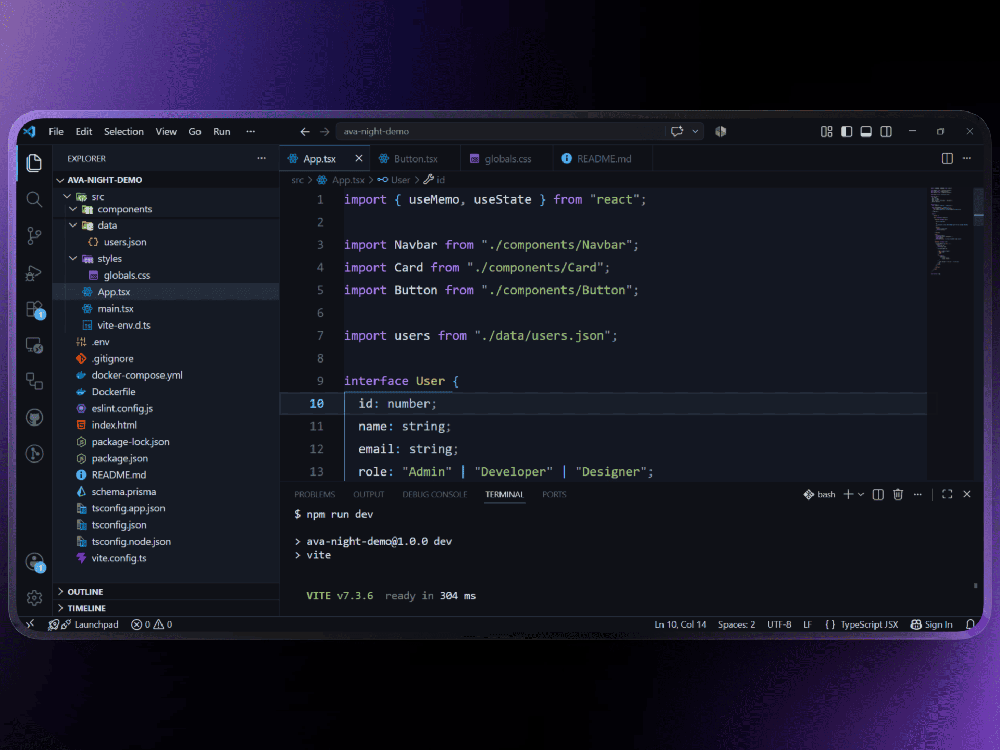
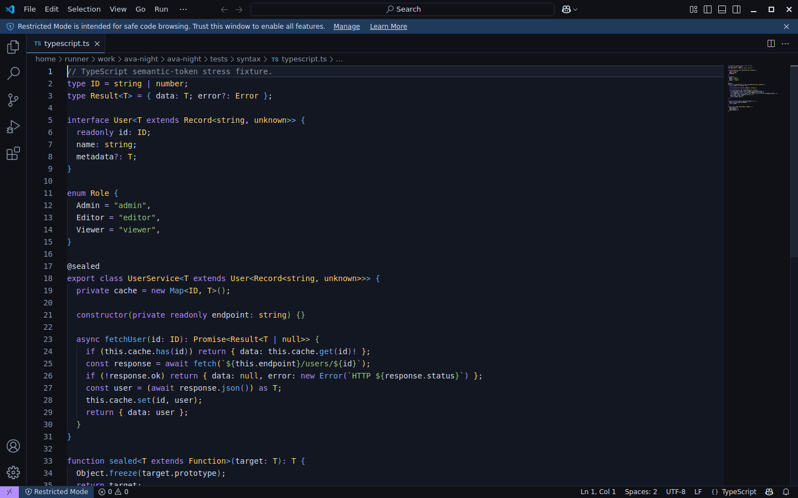
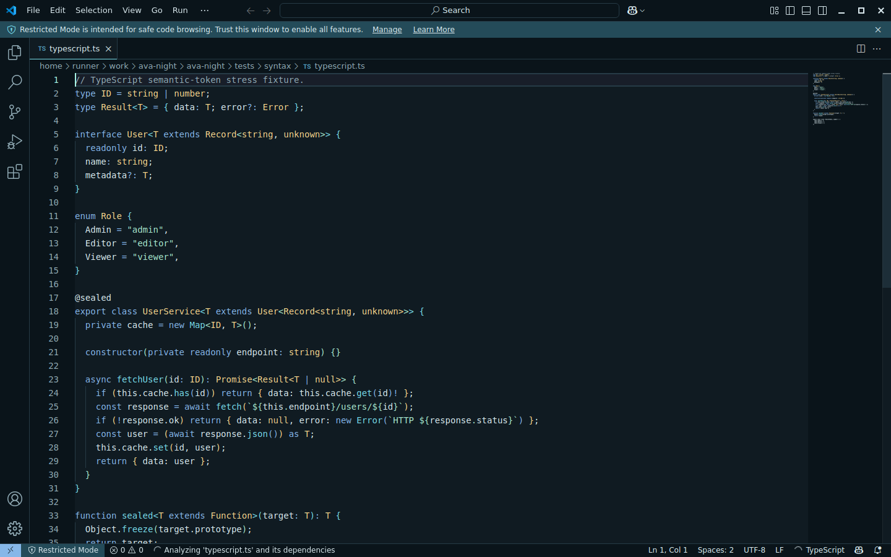
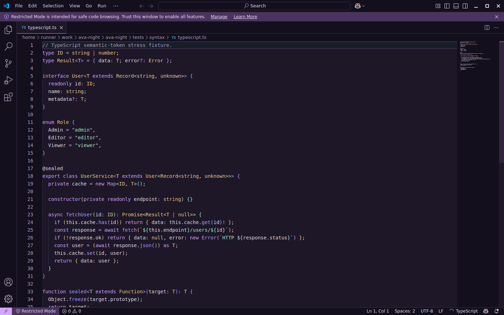
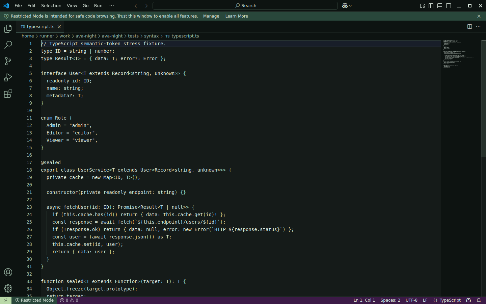

<div align="center">



# 🌙 Ava Night

### Your code. Your quiet corner of the night.

A midnight-inspired **Visual Studio Code theme family** designed to make long coding sessions feel focused, expressive, and easy on the eyes.

**Four atmospheres. One thoughtful color language.**

<p>
  <a href="#-find-your-atmosphere"><strong>Explore the themes</strong></a> ·
  <a href="https://marketplace.visualstudio.com/items?itemName=Ava-91.ava-night"><strong>Install from Marketplace</strong></a> ·
  <a href="#-find-your-atmosphere"><strong>Compare editions</strong></a> ·
  <a href="https://github.com/Ava-91/ava-night/issues"><strong>Give feedback</strong></a>
</p>

[](https://github.com/Ava-91/ava-night/actions/workflows/ci.yml)
[](https://marketplace.visualstudio.com/items?itemName=Ava-91.ava-night)
[](LICENSE)
[](https://code.visualstudio.com/)

</div>

---

## ✨ Find your atmosphere

Your editor is where ideas take shape. Pick a palette that fits the mood you want to work in.

<table>
  <tr>
    <td width="50%" valign="top">
      <a href="docs/screenshots/ava-night.png"></a>
      <h3>🌌 Ava Night</h3>
      The signature midnight palette: deep navy, electric blue, icy cyan, lavender, and mint.
      <br /><sub><a href="docs/screenshots/ava-night.png">View full screenshot ↗</a></sub>
    </td>
    <td width="50%" valign="top">
      <a href="docs/screenshots/moonlit.png"></a>
      <h3>🌙 Ava Night — Moonlit</h3>
      Cooler blue-green surfaces and crisp, icy highlights for a clean, luminous feel.
      <br /><sub><a href="docs/screenshots/moonlit.png">View full screenshot ↗</a></sub>
    </td>
  </tr>
  <tr>
    <td width="50%" valign="top">
      <a href="docs/screenshots/eclipse.png"></a>
      <h3>🪻 Ava Night — Eclipse</h3>
      Plum-black depth with violet and lilac accents: atmospheric, rich, and understated.
      <br /><sub><a href="docs/screenshots/eclipse.png">View full screenshot ↗</a></sub>
    </td>
    <td width="50%" valign="top">
      <a href="docs/screenshots/afterglow.png"></a>
      <h3>🌿 Ava Night — Afterglow</h3>
      Forest-dark surfaces balanced with mint and soft green for a grounded, natural mood.
      <br /><sub><a href="docs/screenshots/afterglow.png">View full screenshot ↗</a></sub>
    </td>
  </tr>
</table>

<sub>These are captured VS Code screenshots from the repository's reproducible capture workflow—not concept mockups. See the <a href="docs/SCREENSHOTS.md">screenshot guide</a> and <a href="docs/screenshots/manifest.json">capture manifest</a>.</sub>

## 🎨 Made for the flow state

- **A palette with purpose.** Keywords, functions, types, strings, numbers, and diagnostics each have a recognizable role.
- **More than syntax.** Editor chrome, terminal, Git decorations, diffs, selections, and focus states share a coordinated visual language.
- **Semantic-aware color.** Semantic-token colors complement TextMate grammar scopes where the language server provides them.
- **Deep without disappearing.** Layered midnight surfaces create depth without relying on a featureless pure-black canvas.
- **Small and self-contained.** A local VS Code theme extension with no runtime service dependency.
- **Checked, not just curated.** Automated checks cover theme metadata, palettes, contrast pairs, fixtures, and packaging.

> Every color should communicate meaning—not compete for attention.

## 🧭 A closer look at the palette

| Purpose | Color | Hex |
| --- | --- | --- |
| Deep background | <span style="color:#0F1117">■</span> | `#0F1117` |
| Editor background | <span style="color:#131722">■</span> | `#131722` |
| Primary text | <span style="color:#D8DEE9">■</span> | `#D8DEE9` |
| Focus and interaction | <span style="color:#61AFEF">■</span> | `#61AFEF` |
| Bright accent | <span style="color:#7FDBFF">■</span> | `#7FDBFF` |
| Structural syntax | <span style="color:#B48EFA">■</span> | `#B48EFA` |
| Strings and success | <span style="color:#98C379">■</span> | `#98C379` |
| Warnings and modified states | <span style="color:#FFD166">■</span> | `#FFD166` |
| Errors and destructive states | <span style="color:#F07178">■</span> | `#F07178` |
| Numeric constants | <span style="color:#E5C07B">■</span> | `#E5C07B` |

The original edition's palette is shown above; Moonlit, Eclipse, and Afterglow adapt the same intentional color roles to their own atmospheres.

## 🚀 Get started

### Install in VS Code

1. [Open Ava Night in the VS Code Marketplace](https://marketplace.visualstudio.com/items?itemName=Ava-91.ava-night) or open **Extensions** with `Ctrl + Shift + X` (Windows/Linux) or `Cmd + Shift + X` (macOS).
2. Install **Ava Night**.
3. Open **Preferences → Color Theme**.
4. Choose **Ava Night**, **Ava Night — Moonlit**, **Ava Night — Eclipse**, or **Ava Night — Afterglow**.

Already have a `.vsix` package? Open Extensions, select the **⋯** menu, and choose **Install from VSIX…**.

### Choose a theme

You can switch editions at any time through **Preferences → Color Theme**. Each edition is a separately defined theme, so its workbench and syntax palettes can be validated independently.

## 🧩 Language coverage

The repository includes representative fixtures for:

**TypeScript · TSX · JavaScript · Python · Rust · Go · C++ · CSS · HTML · JSON · JSONC · Markdown · Shell · SQL · YAML**

Syntax colors depend on each language's grammar. Semantic highlighting also depends on the language server, its settings, and the tokens it supplies.

See [Language support](docs/LANGUAGE-SUPPORT.md) for coverage details and inspection guidance.

## ♿ Accessibility, contrast & quality

Readability matters as much as atmosphere. Ava Night's automated checks validate theme metadata, key palette relationships, semantic-token roles, language fixtures, and VSIX packaging. Core editor, sidebar, and terminal text pairs are checked against a **4.5:1 contrast target**.

That target is a useful check, not a promise that every UI element or every person's display will look perfect. If something is difficult to read, please report the **theme edition**, the **UI or syntax element**, and a screenshot.

- [Accessibility and visual-quality notes](docs/accessibility.md)
- [Screenshot capture and review guide](docs/SCREENSHOTS.md)
- [Marketplace and release checklist](docs/MARKETPLACE-CHECKLIST.md)
- [Open a bug report or suggestion](https://github.com/Ava-91/ava-night/issues)

## 🧪 Run the checks locally

**Requirements:** Node.js 22. VS Code and the VSCE packaging tool are needed for the editor/install smoke checks and screenshot capture.

```bash
git clone https://github.com/Ava-91/ava-night.git
cd ava-night
npm ci
npm test
npm run diagnostics
npm run quality
npm run qa
npm run variants:check
npx --yes @vscode/vsce package --no-dependencies
npm run vsix:smoke
npm run vscode:smoke
npm run screenshots
RELEASE_VERSION=1.4.0 npm run release:check
```

| Command | What it checks |
| --- | --- |
| `npm test` | Unit and regression tests for theme metadata, syntax assets, and contrast |
| `npm run diagnostics` | Writes color, contrast, and fixture reports to `tests/results/` |
| `npm run quality` | Required UI colors, semantic roles, palette integrity, and fixtures |
| `npm run qa` | Diagnostics and theme-family checks |
| `npm run variants:check` | Every selectable edition and key text-contrast checks |
| `npm run vsix:smoke` | Required files and metadata inside the extension package |
| `npm run vscode:smoke` | Installs the VSIX into an isolated profile and launches VS Code with a fixture |
| `npm run screenshots` | Attempts to capture all editions in a real editor; set `CODE_BIN` or `VSIX_PATH` if needed |
| `npm run release:check` | Confirms the release tag matches the package version |

Generated reports are build artifacts and are not committed automatically. Screenshot capture is reproducible, but pixel-identical output is not guaranteed across operating systems, fonts, GPUs, and VS Code versions. See the [screenshot guide](docs/SCREENSHOTS.md) for details.

## 🛠️ Build and contribute

Want to help improve the night?

```bash
git clone https://github.com/Ava-91/ava-night.git
cd ava-night
npm ci
```

Press **F5** in VS Code to launch an Extension Development Host. The local semantic-token inspector is documented in `tools/theme-inspector/README.md`.

Ideas, bug reports, and contributions are welcome. Before reporting a visual issue, mention the edition and include a screenshot when possible.

**[Browse open issues](https://github.com/Ava-91/ava-night/issues) · [Explore the source](https://github.com/Ava-91/ava-night) · [Read the screenshot guide](docs/SCREENSHOTS.md)**

## 📄 License

Ava Night is released under the [MIT License](LICENSE).

---

<div align="center">

**Take a breath. Find your focus. Keep building.** 🌙

<sub>Made for the hours when the world gets quiet and the ideas get loud.</sub>

</div>
