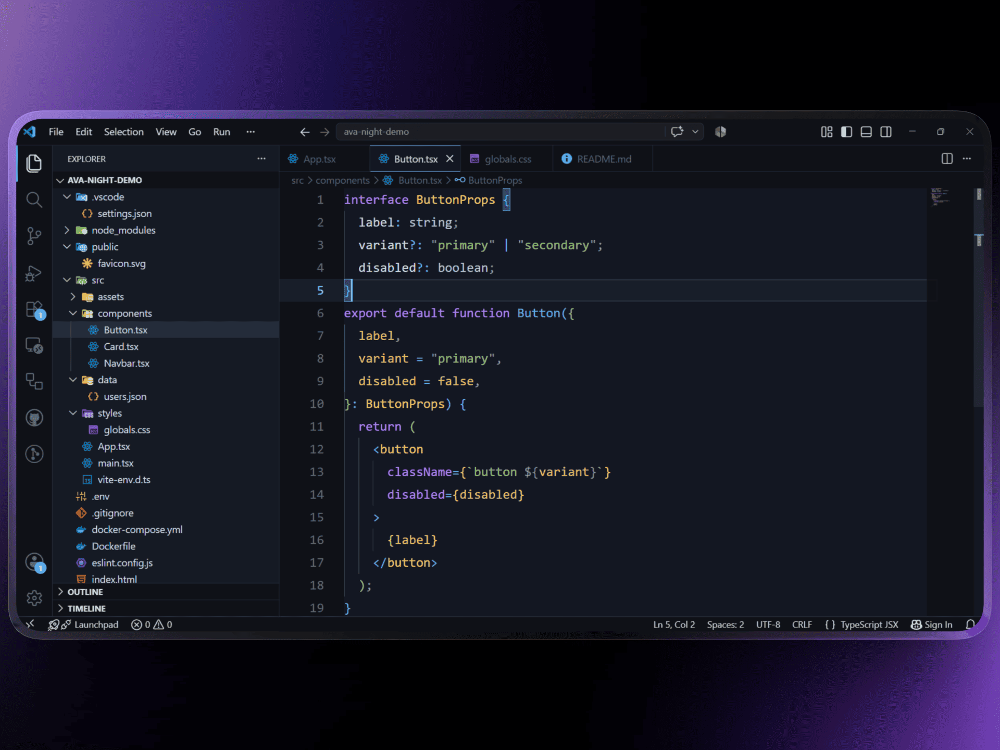
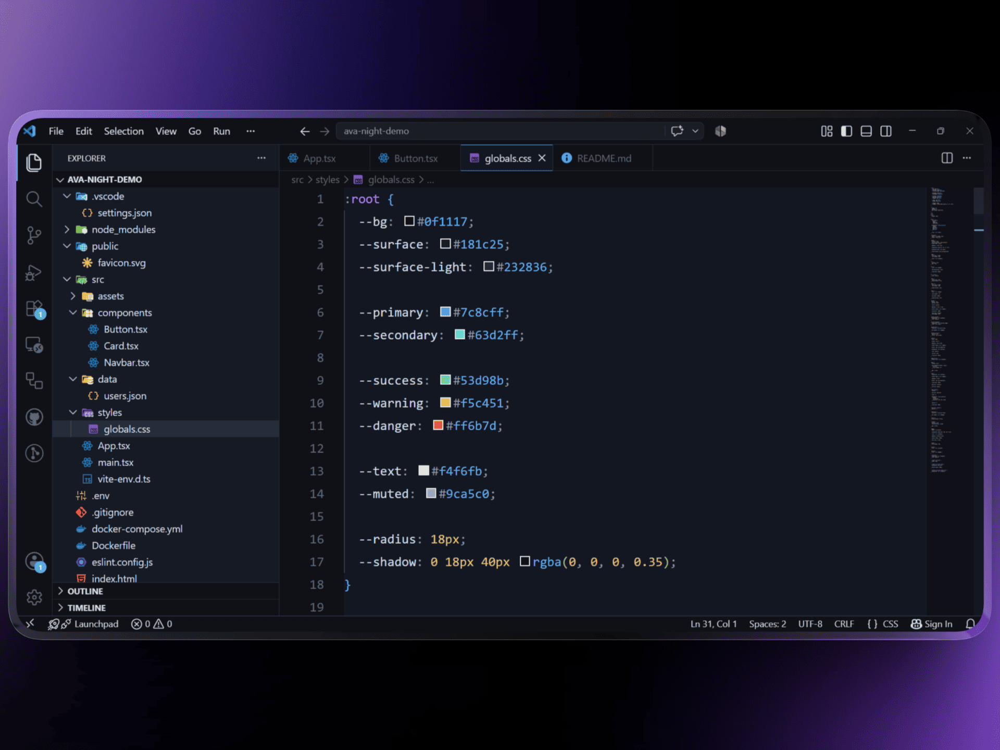
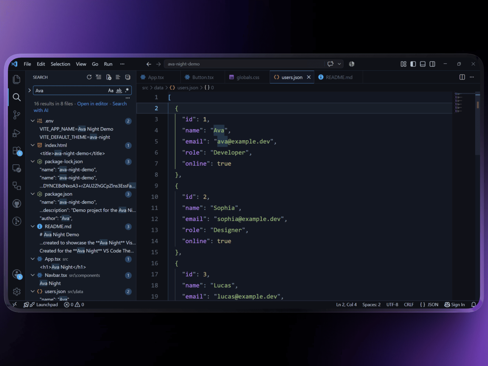

# Ava Night

### Where code meets the quiet of midnight

A calm, midnight-inspired VS Code theme family built around **focus, readable contrast, and meaningful color**.

**Calm • Focused • Readable • Midnight**

[Install](#install) · [Theme editions](#theme-editions) · [Quality checks](#quality--accessibility) · [Contributing](#development)

---

## The idea

Ava Night is for developers who prefer **calm over clutter**. Its visual identity is a moonlit mark outside and a layered midnight workspace inside. Colors are assigned roles so syntax, interaction, and diagnostic states remain recognizable across editions.

- Layered near-black surfaces instead of a flat pure-black canvas
- Electric blue, ice cyan, violet, mint, amber, and coral with defined semantic roles
- Consistent tabs, terminal, sidebar, command palette, selection, focus, and Git states
- Semantic highlighting for supported language-server tokens
- No runtime dependencies or editor animations

## Theme editions

Choose an edition from **Preferences → Color Theme** after installing the extension. All four editions ship in the same VS Code extension.

| Edition | Atmosphere | Signature accents |
| --- | --- | --- |
| **Ava Night** | Balanced midnight navy | Electric blue, ice cyan, violet |
| **Moonlit** | Cool blue-black | Ice cyan, mint, lavender |
| **Eclipse** | Midnight plum | Violet, lavender, mint |
| **Afterglow** | Forest charcoal | Mint, soft sky blue, warm amber |

### Ava Night — original

### Syntax samples

CSS

JSON

The screenshots above show the original Ava Night palette. The newer editions use the same UI structure with their own registered color palettes; variant-specific screenshots should be captured from VS Code before being presented as real screenshots.

## Color philosophy

> **Every color should communicate meaning—not compete for attention.**

| Role | Ava Night | Meaning |
| --- | --- | --- |
| Deep background | \`#0F1117\` | Window and terminal depth |
| Editor background | \`#131722\` | Main reading surface |
| Primary text | \`#D8DEE9\` | Code and essential UI text |
| Primary accent | \`#61AFEF\` | Focus and primary interaction |
| High-attention accent | \`#7FDBFF\` | Cursor and selected emphasis |
| Structural syntax | \`#B48EFA\` | Keywords and language structure |
| Strings / success | \`#98C379\` | String literals and added states |
| Warnings / modified | \`#FFD166\` | Warnings and modified files |
| Errors / deleted | \`#F07178\` | Errors and destructive states |
| Numeric constants | \`#E5C07B\` | Numbers and selected types |

Each variant adjusts the atmosphere and accent colors while keeping semantic roles consistent. Full palette definitions live in \`themes/\`.

## Quality & accessibility

Theme QA is part of the project rather than an informal final check.

\`\`\`sh
npm ci
npm test
npm run diagnostics
npm run quality
npm run qa
npm run vsix:smoke
npm run release:check
\`\`\`

The checks cover:

- Theme metadata, JSON validity, contribution paths, and package contents
- Required UI colors and semantic-token roles
- WCAG contrast calculations for key text and interface states
- Four theme editions and their shared-base relationships
- Fifteen syntax fixtures across TypeScript/TSX, JavaScript, Python, Rust, Go, C++, CSS, HTML, JSON/JSONC, Markdown, Shell, SQL, and YAML
- VSIX payload and release metadata consistency
- Regression coverage for the theme's machine-checkable behavior

Generated reports are written under \`tests/results/\` and are intentionally ignored by Git. Run \`npm run qa\` to regenerate the accessibility/quality report.

**Scope note:** automated contrast and token checks do not prove every rendered state meets every WCAG criterion. The automated QA report is not a pixel-level visual-regression system. Review each edition in a real VS Code window, including selections, focus indicators, terminal output, diagnostics, diffs, inactive tabs, and common extensions. The repeatable screenshot comparison workflow is documented in [docs/THEME-FAMILY.md](docs/THEME-FAMILY.md).

## Install

### VS Code Marketplace

1. Open Extensions with \`Ctrl + Shift + X\`.
2. Search for **Ava Night**.
3. Install the extension.
4. Open **Preferences → Color Theme** and select your edition.

### Install from VSIX

1. Download the VSIX from the [GitHub Releases page](https://github.com/Ava-91/ava-night/releases).
2. Open Extensions and select **⋯ → Install from VSIX...**.
3. Choose the downloaded file and select the theme in Color Theme.

## Development

\`\`\`sh
git clone https://github.com/Ava-91/ava-night.git
cd ava-night
npm ci
npm test
\`\`\`

Press **F5** in VS Code to launch an Extension Development Host.

| Command | Purpose |
| --- | --- |
| \`npm test\` | Run automated unit and theme-family tests |
| \`npm run diagnostics\` | Generate palette, contrast, and fixture reports |
| \`npm run quality\` | Validate required colors, semantic roles, and contrast |
| \`npm run qa\` | Run the complete machine-checkable QA audit |
| \`npm run vscode:smoke\` | Install the VSIX and launch a representative fixture in VS Code |
| \`npm run vsix:smoke\` | Validate the packaged VSIX contents and metadata |
| \`npm run release:check\` | Validate release tag/version and publisher metadata |

## Language support

The fixture matrix under \`tests/syntax\` includes TypeScript, TSX/React, JavaScript, Python, Rust, Go, C++, CSS, HTML, JSON, JSONC, Markdown, Shell, SQL, and YAML. Explicit semantic-token roles include functions, methods, macros, builtins, keywords, namespaces, modules, types, classes, interfaces, enums, enum members, type parameters, strings, regexps, decorators, annotations, labels, events, numbers, variables, properties, parameters, operators, modifiers, and comments.

A fixture means the repository has a test sample for that language; semantic coverage depends on the language server and does not guarantee every role is emitted by every extension.

## Contributing

Bug reports and palette suggestions are welcome through [GitHub Issues](https://github.com/Ava-91/ava-night/issues). For a color change, please include the affected token, intended meaning, contrast evidence, and screenshots from the actual VS Code UI when the rendering matters.

## License

MIT
